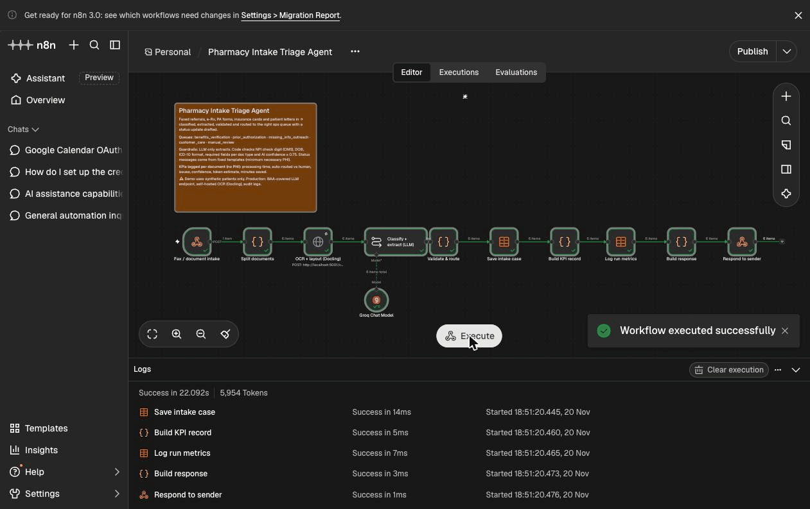
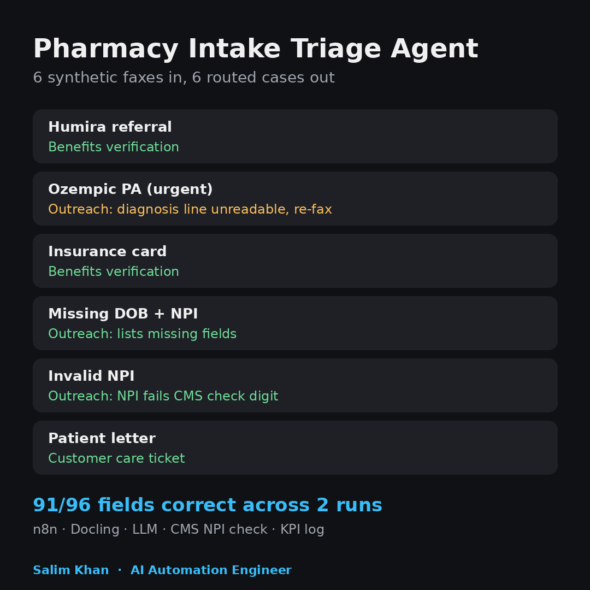

# Pharmacy Intake Triage Agent (n8n + Docling + LLM)

Specialty pharmacies receive referrals, e-prescriptions, prior authorization (PA) forms, insurance cards and patient letters by fax and upload. Today an intake specialist opens each one, works out what it is, re-keys patient, prescriber and insurance data, checks it, and routes it to the right team. This workflow does that first pass automatically and hands people only the cases that need judgement.

> All data in this project is synthetic. No real patient information was used.

## What it does
1. **Receive**: webhook accepts one or many documents per request (fax server, e-fax inbox or upload form can POST to it).
2. **Read**: Docling (self-hosted) runs OCR + layout analysis and returns Markdown with tables preserved.
3. **Classify + extract**: LLM returns doc type, confidence and structured fields (patient, prescriber, medication, insurance, ICD-10). It is told to copy values exactly and return null instead of guessing.
4. **Validate (code, not AI)**:
   - Prescriber NPI check digit (CMS Luhn algorithm with 80840 prefix)
   - Required fields per document type
   - Date of birth readable and plausible
   - ICD-10 code format
   - AI confidence >= 0.75
5. **Route** to an ops queue and draft the status update from a fixed template:

| Queue | When | Next action |
|---|---|---|
| benefits_verification | Clean new prescription or insurance card | Run benefits check |
| prior_authorization | Clean PA form with diagnosis + payer | Submit PA (flag URGENT) |
| missing_info_outreach | Required field missing, bad NPI, bad DOB/ICD-10 | Message prescriber office listing exactly what is missing |
| customer_care | Patient letter / message | Open care ticket with a PHI-free summary |
| manual_review | Low confidence, unknown type, AI output error | Intake specialist classifies manually |

6. **Record**: case saved to `pharmacy_intake_cases`; one metrics row per document saved to `automation_runs` (no PHI).
7. **Respond**: the caller gets case ID, queue, next action, issues and the drafted message.

## Test results (6 synthetic faxes, 2026-11-20)

| Document | Expected | Result |
|---|---|---|
| Humira referral (clean) | benefits_verification | ✅ all fields correct |
| Ozempic PA form, URGENT | prior_authorization | ⚠️ diagnosis line unreadable after fax noise → AI returned null (did not guess) → routed to missing_info_outreach |
| Cigna insurance card | benefits_verification | ✅ all fields correct |
| Enbrel referral, no DOB, no NPI | missing_info_outreach | ✅ caught both missing fields |
| Dupixent referral, NPI with wrong check digit | missing_info_outreach | ✅ caught invalid NPI |
| Patient letter about late delivery | customer_care | ✅ correct |

- **Run 1: 46/48 fields correct. Run 2: 45/48. Combined 91/96 (95%).** Doc type 12/12 across both runs.
- Misses: the PA fax's diagnosis line was unreadable after fax noise in both runs (AI returned null, did not guess, case failed safe to outreach), and in run 2 OCR dropped a space in "Blue Cross Blue Shield".
- 6 documents end-to-end in about 17-22 s per batch, about 3,300 tokens per batch, average AI confidence 0.95.
- 0 of 6 needed manual classification; 3 of 6 needed a human action (outreach / care), which is correct for those documents.

Demo video (75 s, narrated): [assets/pharmacy-intake-triage-demo.mp4](assets/pharmacy-intake-triage-demo.mp4)

## KPIs (set before go-live, logged per document)
| KPI | Source | How it is measured |
|---|---|---|
| Cycle time (receipt → routed) | automation_runs.processing_ms | webhook receipt to case saved |
| Touchpoints per document | auto_routed, needs_human | documents needing manual classification or data entry |
| Error rate | QA sample vs extracted_json | weekly 20-document audit by intake lead |
| Hours saved | est_minutes_saved | 8 min per auto-routed document (assumption: replace with measured baseline from shadowing) |
| AI accuracy drift | confidence, issue_count | alert if weekly avg confidence < 0.85 or manual_review > 15% |
| Cost | est_input_tokens, est_output_tokens | tokens × provider price, reviewed monthly |

## HIPAA / production notes
- Demo uses Groq with synthetic data. Production must use an LLM endpoint covered by a BAA (e.g. Azure OpenAI, AWS Bedrock) or a self-hosted model.
- OCR runs locally (Docling), so document images never leave the network.
- Metrics table holds no PHI (case ID + numbers only). `patient_ref` is a pseudonymous hash for joining.
- Status messages use minimum necessary PHI (first name or initials) and come from fixed templates; the AI never writes patient-facing promises.
- Next steps with Engineering: secrets in a vault, audit log of every routing decision, role-based access to the cases table, retention policy.

## Run it yourself
1. Start Docling: `docker run -d --name docling-serve -p 5001:5001 quay.io/docling-project/docling-serve-cpu`
2. In n8n, import `workflow/pharmacy-intake-triage-agent.json`.
3. Create two Data Tables (`pharmacy_intake_cases`, `automation_runs`) with the columns listed in the two "Save"/"Log" nodes, and select them in those nodes.
4. Add a Groq (or any chat model) credential to the model node.
5. Click "Execute workflow", then: `curl -F "file1=@referral.pdf" -F "file2=@card.jpg" http://localhost:5678/webhook-test/pharmacy-intake`

## Files
- `workflow/pharmacy-intake-triage-agent.json`: n8n workflow (credentials removed)
- `assets/`: demo video and screenshots
- `docs/PROCESS_MAP.md`: current vs future state
- `docs/SOP.md`: how intake staff use the queues
- `docs/PROMPT_TEMPLATE.md`: reusable classify + extract prompt
