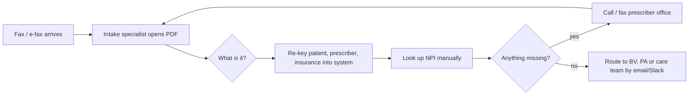
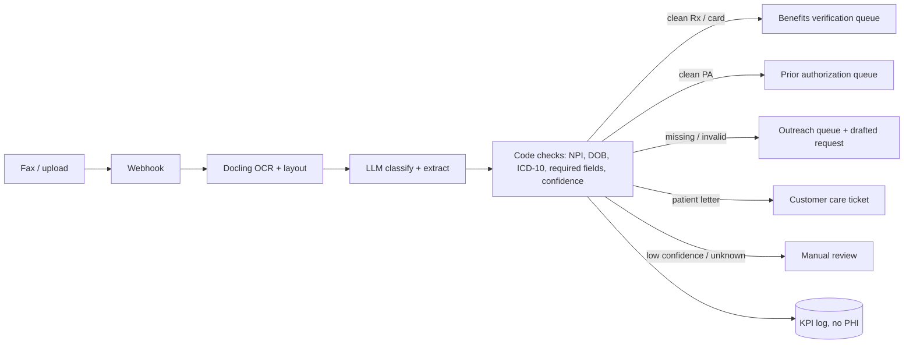

# Process map: pharmacy document intake

## Current state (manual)

Pain points to confirm while shadowing: re-keying errors, NPI lookups, documents sitting unread, missing-info loops, no measurement of cycle time.

## Future state (automated first pass)

Removed steps: manual classification, re-keying, NPI lookup, writing the outreach request. Humans keep: judgement calls, clinical questions, payer calls.
